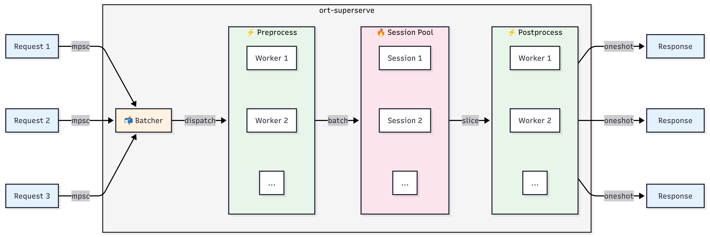

# ort-superserve

A "thin" asynchronous ONNX Runtime session orchestrator for high-throughput model serving. Built on top of [`ort`]. Designed for simplicity, flexibility, and performance.

Orchestrates a pool of ONNX sessions with dynamic batching and parallel processing, enabling thousands of concurrent requests to share the same model without mutex contention on the hot path.

## Architecture



## Key Features

- **Lock-free**: Unlike the naive approach of wrapping an ONNX session in `Arc<Mutex<Session>>` which creates a bottleneck under load, ort-superserve uses an actor model where requests flow through channels instead of locks, and a session pool where multiple ONNX sessions run in parallel on dedicated threads—zero mutex on the hot path.

- **Dynamic batching**: Incoming requests are collected into batches before being sent to inference. The batcher waits until either `max_batch_size` is reached or `max_wait_time` elapses, ensuring optimal GPU/CPU utilization. Without batching, each request would incur the full overhead of model invocation, resulting in poor throughput.

- **Built on [`ort`] crate**: Uses the mature ONNX Runtime bindings directly, supporting all execution providers that ONNX Runtime offers: CPU (default), CUDA, TensorRT, XNNPACK, and CoreML. This means you can deploy the same model on different hardware accelerators without code changes.

[`ort`]: https://crates.io/crates/ort

- **Any inputs and outputs**: Models can have any number of named inputs and outputs of any common element type (`f32`, `f64`, `i8`–`i64`, `u8`–`u64`, `bool`). A detector returning separate `boxes`, `scores` and `i64` `labels` just works, and you control how each output is split back per request.

- **Session pool**: On multi-core servers, scaling a single ONNX session with more threads hits diminishing returns due to lock contention and memory bandwidth limits. A session pool runs multiple independent sessions in parallel, each with fewer threads, achieving near-linear scaling with core count. This is essential for high-throughput serving on modern hardware.

## Quick Start

```toml
[dependencies]
ort-superserve = "0.4"
```

The common case, one `f32` input and one `f32` output:

```rust
use anyhow::Result;
use ndarray::Array3;
use ort_superserve::{create_env, Input, Output, Outputs, Server, ServerConfig};

// 1. Define your input type
struct MyInput {
    data: Array3<f32>,
}

impl Input for MyInput {
    type Preprocessed = Array3<f32>; // any ndarray array, sent to the model's input
    type Context = ();

    async fn preprocess(self) -> Result<(Self::Preprocessed, Self::Context)> {
        // Your preprocessing logic (runs in parallel)
        Ok((self.data, ()))
    }
}

// 2. Define your output type
struct MyOutput {
    scores: Vec<f32>,
}

impl Output for MyOutput {
    async fn postprocess(outputs: Outputs, _context: ()) -> Result<Self> {
        // Your postprocessing logic (runs in parallel). The batch axis is
        // already removed: this is the output for this request only.
        let raw = outputs.first::<f32>()?;
        Ok(MyOutput {
            scores: raw.iter().cloned().collect(),
        })
    }
}

// 3. Create server and run inference
#[tokio::main]
async fn main() -> Result<()> {
    // Create the ONNX Runtime environment explicitly (one per process; clone it
    // to share it between servers).
    let env = create_env()?;

    let config = ServerConfig::new()
        .with_num_sessions(4)
        .with_threads_per_session(2)
        .with_max_batch_size(16)
        .with_environment(env);

    let server = Server::<MyInput, MyOutput>::from_file("model.onnx", config).await?;

    let output = server.infer(MyInput { data: Array3::zeros((3, 224, 224)) }).await?;

    server.shutdown();
    Ok(())
}
```

## Multiple inputs and outputs

`preprocess` produces each request's `Inputs`: named tensors without the batch axis. Any `ndarray` array converts into an `Inputs` holding one unnamed tensor, which goes to the model's first input (or the one set with `with_input_name`). For several inputs, name them:

```rust
use ort_superserve::Inputs;

impl Input for TextInput {
    type Preprocessed = Inputs;
    type Context = ();

    async fn preprocess(self) -> Result<(Inputs, ())> {
        let len = self.token_ids.len();
        let inputs = Inputs::new()
            .with("input_ids", Array1::from(self.token_ids))     // i64
            .with("attention_mask", Array1::<i64>::ones(len));   // i64
        Ok((inputs, ()))
    }
}
```

`postprocess` receives each request's `Outputs`. By default every model output is fetched; read them by name and element type:

```rust
impl Output for Detections {
    async fn postprocess(outputs: Outputs, _context: ()) -> Result<Self> {
        let boxes = outputs.get::<f32>("boxes")?;    // [num_boxes, 4]
        let scores = outputs.get::<f32>("scores")?;  // [num_boxes]
        let labels = outputs.get::<i64>("labels")?;  // [num_boxes]
        // ...
    }
}
```

Use `ServerConfig::with_output(OutputSpec::new("name"))` (or `with_output_name("name")`) to fetch only some outputs, in the order you add them. Requests whose inputs do not match the model (missing or unknown names, wrong element type or shape) fail individually with a clear error; the rest of the batch is unaffected.

## Splitting outputs per request

Each output is split back into one tensor per request by its `Split`:

- **`Split::BatchAxis`** (default): axis 0 is the batch axis; request `i` gets row `i`, with the batch axis removed. The row count must match the batch exactly, and when the model's metadata shows that axis 0 is *not* the batch dimension (a fixed size other than the batch size, a dynamic size in a fixed-batch model, or a differently named dimension), every request fails with an error instead of possibly receiving another caller's rows.
- **`Split::BatchIndex`**: rows are assigned by a batch index, as produced by NMS models. The index can be a column of the output itself or a separate output; rows belonging to padded batch entries are dropped.
- **`Split::Custom`**: your own function, receiving the whole batched output and a `SplitContext` describing the batch.

```rust
use ort_superserve::{OutputSpec, ServerConfig, Split};

// NMS model whose `detections` rows are [batch_id, x1, y1, x2, y2, score, class]
let config = ServerConfig::new()
    .with_output_split("detections", Split::batch_index_column(0));

// NMS model with separate outputs and a `batch_index` output
let by_image = || Split::batch_index_from("batch_index", None);
let config = ServerConfig::new()
    .with_output_split("boxes", by_image())
    .with_output_split("scores", by_image())
    .with_output_split("labels", by_image());
```

## Fixed batch sizes and variable-length inputs

**Fixed batch size.** If the model was exported with a fixed batch size, batches are capped at that size and partial batches are padded up to it. Padded rows are dropped before splitting, so they never reach a caller. Nothing needs to be configured.

**Dynamic dimensions.** When an input has a dynamic dimension besides the batch one (e.g. `[batch, sequence]`), requests of different lengths share a batch: each is padded to the longest request with the input's padding value (`0` by default):

```rust
use ort_superserve::{InputSpec, ServerConfig};

let config = ServerConfig::new()
    .with_input(InputSpec::new("input_ids").with_pad_value(0.0))      // pad token id
    .with_input(InputSpec::new("attention_mask").with_pad_value(0.0)); // ignore padding
```

Every output axis that follows a padded dimension is cut back to the request's own length, so a caller only gets the positions that belong to its request. Axes are matched by their symbolic dimension name in the model (e.g. both input and output use `sequence`). If the exporter generated the names instead (like `unk__0`), the server refuses to start and names the axis; declare it with `OutputSpec::with_crop_axis` or `OutputSpec::with_uncropped_axis`. Both kinds of padding work together.

Inputs that carry no batch axis (e.g. an NMS threshold scalar) are passed through unchanged; mark them with `InputSpec::with_batched(false)` if the model does not declare them as scalars.

## Per-request context

Postprocessing often needs to know something about the original request, such as the original image size to map detections back from the model's input resolution. `preprocess` returns that alongside the tensor data as the input's `Context`; the library keeps it out of the batch and hands it to the same request's `postprocess`.

```rust
struct ImageScale { original: (u32, u32), model_input: (u32, u32) }

impl Input for DetectionInput {
    type Preprocessed = Array3<f32>;   // stacked into the batch tensor
    type Context = ImageScale;         // delivered to this request's postprocess

    async fn preprocess(self) -> Result<(Self::Preprocessed, Self::Context)> {
        let original = self.image.dimensions();
        let tensor = resize_and_normalize(&self.image, (640, 640));
        Ok((tensor, ImageScale { original, model_input: (640, 640) }))
    }
}

impl Output<ImageScale> for Detections {
    async fn postprocess(outputs: Outputs, scale: ImageScale) -> Result<Self> {
        // Decode boxes in model space, then rescale them with `scale`
        decode_boxes(outputs.first::<f32>()?, scale)
    }
}
```

Use `type Context = ();` when postprocessing needs nothing; `Output` defaults to `Output<()>`. See `examples/person_detection.rs` for a complete example.

## Configuration

```rust
use ort_superserve::{ServerConfig, ExecutionProvider, create_env};
use std::time::Duration;

let env = create_env()?;

let config = ServerConfig::new()
    .with_num_sessions(4)                              // Number of ONNX sessions in the pool
    .with_threads_per_session(2)                       // Threads per session
    .with_max_batch_size(16)                           // Maximum batch size
    .with_min_batch_size(1)                            // Minimum batch size
    .with_max_wait_time(Duration::from_millis(10))     // Max wait for batching
    .with_execution_provider(ExecutionProvider::Cpu)   // CPU execution (default)
    .with_input_name("images")                         // Input for unnamed tensors (default: first)
    .with_pad_value("images", 0.0)                     // Padding value for an input (default: 0)
    .with_output_name("logits")                        // Fetch only these outputs (default: all)
    .with_environment(env);                            // ONNX Runtime environment (see below)
```

### ONNX Runtime environment

ONNX Runtime allows only one environment per process, and creating a second one is an error.

- **Without `with_environment`**: the server creates its own environment. Convenient for quick tests and single-server programs, but starting a second server this way in the same process fails.
- **With `with_environment(env)`**: create the environment once with `create_env()` (at startup or lazily) and give a clone to every server. Servers can then be created, dropped and recreated freely.

```rust
use ort_superserve::create_env;

let env = create_env()?; // once per process

let detector = Server::<ImageInput, Detections>::from_file(
    "detector.onnx",
    ServerConfig::new().with_environment(env.clone()),
).await?;
let classifier = Server::<ImageInput, Classes>::from_file(
    "classifier.onnx",
    ServerConfig::new().with_environment(env.clone()),
).await?;
```

## License

MIT
